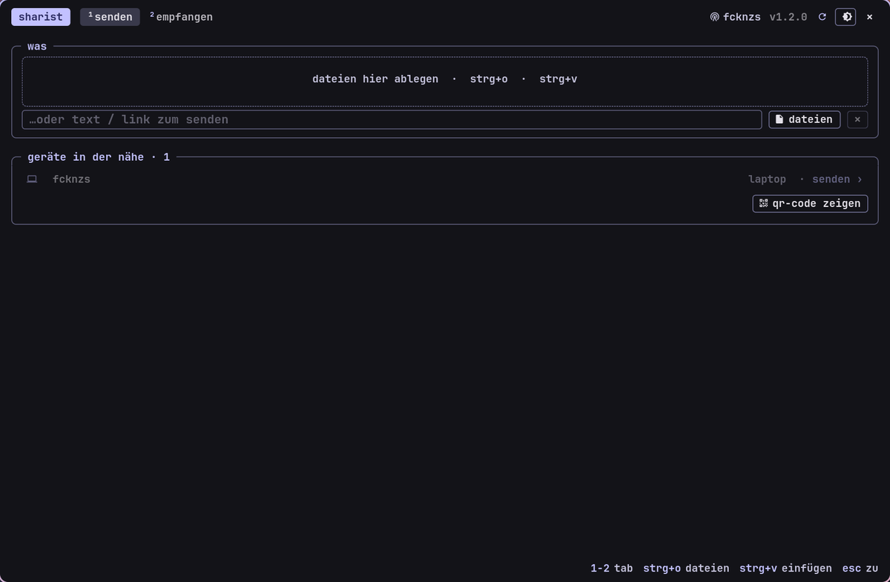

<!-- gh-header -->
<div align="center">


# sharist

**quick share for linux**

   

</div>

<p align="center"></p>

<p align="center"><!-- gh-note --><sub>tip: the glass button (󰃝, top right) makes the window see-through, like the terminal – needs a compositor with blur, e.g. hyprland.</sub></p>

quick share (formerly nearby share) for linux in the terminal look of the suite (gtk4): android phones send the
laptop files, photos, text, links and wifi credentials – and the laptop sends back. all directly over wifi,
encrypted, no google account, no cloud.

## install – linux

```bash
gh auth login                                   # login once (repository is private, invitation needed)
gh repo clone invincible-nix/sharist ~/sharist-src
cd ~/sharist-src && ./install.sh
```

the installer asks for the system packages (gtk4, pygobject, bluetooth – password once), copies sharist to
`~/.local/share/sharist`, sets up a small python environment there (zeroconf, protobuf, qrcode) and creates
the command `sharist` and a menu entry. if a firewall is running (ufw/firewalld) it offers to open
**port 37521/tcp** – phones can't get through without it. last it asks about autostart in the background, so phones
see the laptop even with the window closed.

## usage

* **¹ senden** – drag files into the window, ctrl+o, ctrl+v or `sharist file…`; type text/links into the field.
nearby phones show up by themselves, one click sends. the phone shows the request with a pin.
if sharist doesn't find the phone: **qr-code zeigen** and scan it with the phone camera – the phone then
connects by itself and doesn't ask again.
* **² empfangen** – on the phone "share → quick share → *your device name*". sharist shows device, content and pin,
accept/decline in the window or right in the notification. files land in `~/Downloads`
(changeable), text goes straight to the clipboard, links can be opened from the notification.
* closing only hides the window; `sharist --toggle` suits a keybinding,
`sharist --daemon` the autostart, `sharist --quit` exits.

## so the phone finds the laptop

* same wifi, bluetooth on on the phone
* quick share on the phone: visibility **"everyone"** (or "everyone for 10 minutes")
* guest networks / campus wifi (eduroam) often block devices from talking to each other – use a phone hotspot then

## runs on

| system | status |
| --- | --- |
| arch (hyprland) | tested |
| ubuntu 24.04+, fedora 40+, openSUSE | should work |

sending to the phone needs bluetooth (bluez) so android starts its quick share advertising; without bluetooth
the qr code remains. the protocol follows the description of [neardrop](https://github.com/grishka/NearDrop).

## update / remove

```bash
./update.sh      # fetches the new version and installs it
./uninstall.sh   # removes sharist (received files and ~/.config/sharist stay)
```

<!-- gh-suite -->
## the -ist suite

all apps share one look (terminal style, colors from your wallpaper via matugen), one installer and the same shortcuts.

| app | what it does |
| --- | --- |
| [scourge](https://github.com/danger-inc/scourge-public) | inspect, edit, record, cut – and installs the others |
| [notist](https://github.com/danger-inc/notist-public) | notes · words · latex |
| [filist](https://github.com/danger-inc/filist-public) | file explorer + file dialog |
| [datist](https://github.com/danger-inc/datist) | calendar |
| [mailist](https://github.com/danger-inc/mailist-public) | mail |
| [musicalist](https://github.com/danger-inc/musicalist-public) | youtube music |
| [linguist](https://github.com/danger-inc/linguist) | translator + hover corner |
| [wallist](https://github.com/danger-inc/wallist) | wallpapers |
| [inquirist](https://github.com/danger-inc/inquirist) | launcher |

dotfiles with the matching hyprland setup: [danger-inc/dotfiles](https://github.com/danger-inc/dotfiles)
